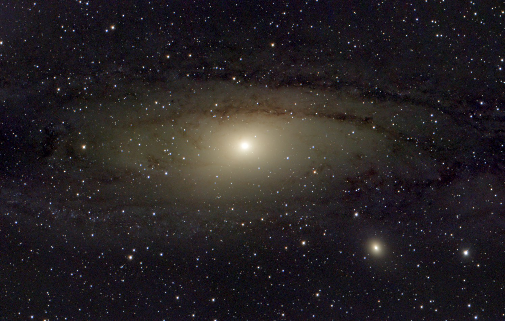
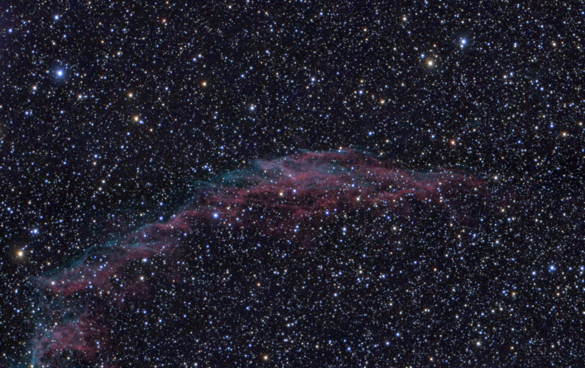
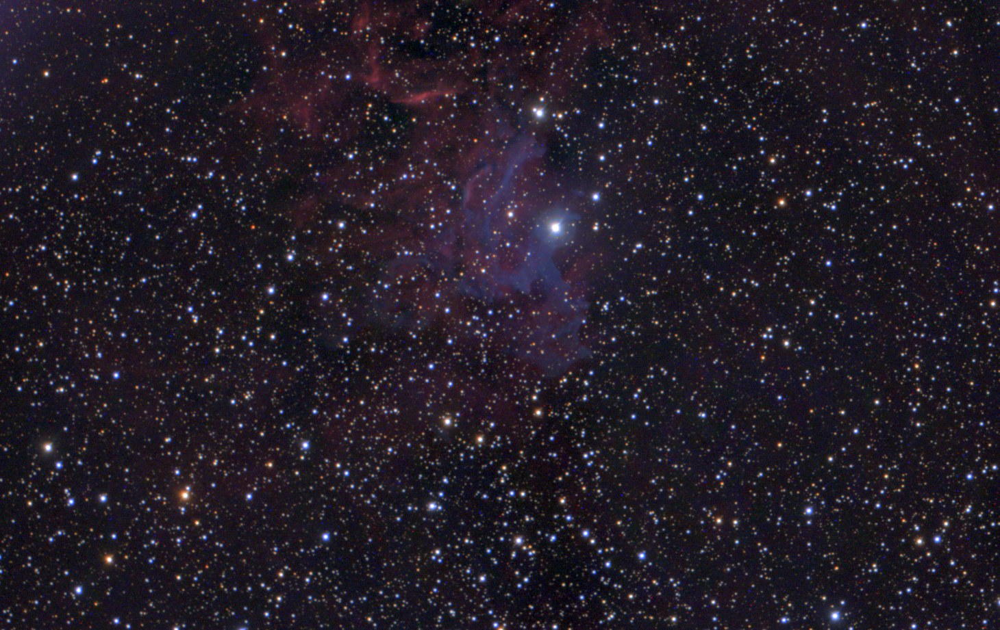
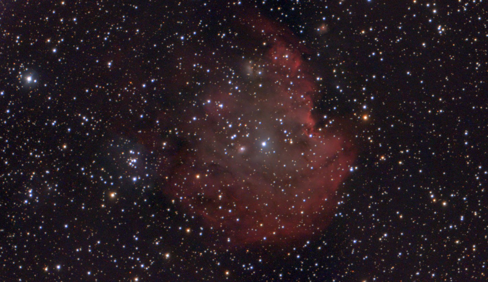

# Celestron Origin Monitor

Open-source monitor and unattended-observing toolkit for the **Celestron Origin** smart telescope (152 mm RASA, f/2.2, alt-az mount, 3056 x 2048 colour sensor).
It started as a macOS GUI (generated with Claude.AI); it now also runs **headless** on Linux behind a small JSON control port, analyses every frame
(focus, transparency, cloud, sky brightness, pointing), keeps a live stack per target, and can run a whole night unattended under the supervision of a
script or an AI session.

On macOS with the Xcode tools installed, `make run` generates the Xcode project and builds a release with a self-explanatory GUI (unchanged).
Everything below describes the headless/Linux route that was used to image on **2026-10-09/10 from Cambridge, UK**, with the results and the problems met.



## Contents

1. [Results of the first full unattended night](#results-of-the-first-full-unattended-night)
2. [What you need](#what-you-need)
3. [Build](#build)
4. [Running the app](#running-the-app)
5. [Control interface reference](#control-interface-reference)
6. [Observing runbook, step by step](#observing-runbook-step-by-step)
7. [Reading the analysis](#reading-the-analysis)
8. [Troubleshooting: symptom, cause, fix](#troubleshooting-symptom-cause-fix)
9. [Tools](#tools)
10. [Files and directories](#files-and-directories)
11. [Audit trail: weather, instrument, software, and my own mistakes](#audit-trail)
12. [Open items](#open-items)

---

## Results of the first full unattended night

Live-stack previews as produced by the app (background extraction, colour neutralisation, hyperbolic stretch; no further processing). Frame field of view
is about 75 x 50 arcmin (1.478 arcsec per pixel at full resolution; the stacks are 1528 x 1024 at 2.956 arcsec per pixel).

| Target | Stack | Settings | When (BST) |
|---|---|---|---|
| Andromeda galaxy (M31), with M32 | 203 frames, 1,222 s | 6 s, ISO 800 | about 21:38-22:28 (with gaps for cloud and tests) |
| Eastern Veil (NGC 6992) | 302 frames, 6,040 s | 20 s, ISO 200 | 23:11-01:09 |
| Flaming Star Nebula (IC 405) | 321 frames, 6,420 s | 20 s, ISO 200 | 01:18-03:25 |
| Monkey Head Nebula (NGC 2174) | 231 frames, 4,620 s | 20 s, ISO 200 | 03:40-05:10 (slewed 03:26) |

The three 20 s nebula stacks total 17,080 s (4.7 h); with Andromeda the night is 18,302 s (5.1 h) of stacked data. In total 1,415 FITS frames (17.7 GB)
were written to disk, of which 1,012 were taken by the in-app sequencer (920 clear, 28 hazy, 11 patchy, 37 cloudy, 16 unreadable).

| | |
|---|---|
|  **Eastern Veil**, NGC 6992 |  **Flaming Star**, IC 405 |
|  **Monkey Head**, NGC 2174 |  **Andromeda**, M31 |

Per-frame measurements for the whole night are in `sequence_20261009.jsonl` and `sequence_20261010.jsonl`, and the quality references (focus HFR,
dark-sky level, transparency) in `references_20261009.md`, all in the data directory.

---

## What you need

* A Celestron Origin on your network (it listens on port 80; ours was 192.168.1.195). The app talks to it over a WebSocket and downloads FITS over HTTP.
  The telescope's own disk is small (58 GB, about 33 GB free when we looked). Sample captures (`RunSampleCapture`, what this app uses) are written to a temporary
  slot on the telescope that is reused for each frame. The telescope's own imaging session (`RunImaging`) is different: it stores frames locally and does **not**
  delete them after they are downloaded, so the disk fills up (see the audit trail).
* A Linux or macOS host. The host should be on **one** network interface, preferably wired: a second interface with a default route confuses things.
  Frames are 12.5 MB each, so a 100 Mb/s link costs about 1 s per frame.
* Qt 6 with Core, Gui, Widgets, Network and WebSockets, and `qmake6`. Plain `qmake` on many systems is Qt 5 and will fail.
* Python 3 for the helper tools: `numpy`, `scipy`, `astropy`, `opencv-python` (the tools), nothing beyond the standard library for `originctl.py`.
* Free disk space on the data disk: about 12.5 MB per frame; a full night was 17.7 GB plus about 0.7 GB of stacks.
* Your own **horizon profile** (buildings, trees, fences): edit `tools/horizon.json` (see the runbook). Ours was north 40 degrees (foliage), east and west 30 degrees
  (fences), south 35 degrees (buildings; the height was assumed, not measured).

## Build

Linux (what was used):

```
mkdir -p build/shadow && cd build/shadow
qmake6 ../../CelestronOriginMonitor.pro
make -j8
# binary: build/shadow/build/CelestronOriginMonitor
```

Do not run `make -f Makefile.master` with no target: its default target is `clean` and wipes `build/`. On macOS use `make run` as before.
The `.pro` file is the single list of sources (`Sequencer.cpp`, `ControlServer.cpp`, `SkyMonitor.cpp`, `LiveStacker.cpp` and so on).

## Running the app

GUI: `CelestronOriginMonitor` (the macOS route described at the top; the GUI was not exercised on Linux). Headless, with the control port:

```
CelestronOriginMonitor --headless --connect 192.168.1.195 [--control-port 8765] [--control-raw]
```

* The control server binds to **127.0.0.1 only**. `--control-raw` additionally allows `send` (arbitrary telescope commands).
* **Run exactly one instance.** The telescope accepts one client, and a stale second process holds the port or the telescope. Check with
  `pgrep -xc CelestronOrigin` (the process name is truncated to 15 characters; `pgrep -f` and `grep` also match your own shell). Start only when it prints 0.
* Start it detached so it survives your shell: `setsid nohup CelestronOriginMonitor --headless --connect HOST > log 2>&1 &`.
* Quit cleanly with `{"cmd":"quit"}` (it saves the live stack); never kill it while a capture is in flight if you can avoid it.
* **Data directory**: `$ORIGIN_DATA_DIR`, default `/mnt/fits-backup/claude` when that path exists, is writable and is on a different filesystem from `/`
  (so frames never fill the root disk under an unmounted mount point); otherwise `~/Pictures/CelestronOrigin`. Change the default in `DataDir.hpp`.

## Control interface reference

Newline-delimited JSON over TCP to 127.0.0.1:8765. One request per line, one reply per line, `{"ok":true,...}` or `{"ok":false,"error":"..."}`.
Requests are handled one at a time; commands that wait for the telescope (`snapshot`, `goto`, `initialize`) block later ones on the same connection.

From a shell use `tools/tcp.sh '{"cmd":"status"}' [timeout_s]` (plain bash `/dev/tcp`, keeps the connection open until the reply).
Do **not** use `nc -q0`, `socat` or anything that closes its write side right after sending: a half-closed client crashed the server (open bug, see below).
`originctl.py` wraps most of the same commands (`status`, `mount`, `goto`, `snapshot`, `analysis`, `events`, `target`, `stack`, `monitor`, `initialize`, focus sweep;
every command prints one JSON object). It has no `sequence` subcommand: use `tools/tcp.sh` for that.

| Command | Arguments | What it does |
|---|---|---|
| `ping`, `status` | | Liveness; connection, camera settings, latest TaskController/Focuser status |
| `connect` | `host`, `port`=80 | Connect to a telescope |
| `set` | `exposure` (s), `iso`, `binning` | Sets the **live-stream** camera parameters (see "The live exposure" below) |
| `snapshot` | `dir`, `timeout`=30 | One raw 16-bit FITS capture, saved to the data directory (refused while a sequence runs) |
| `mount_status` | | Ra/Dec/Alt/Az (radians), alignment, tracking, `IsGotoOver` |
| `goto` | `ra_hours`, `dec_deg` (J2000), `timeout`=180 | Slew; returns when the mount reports done. The firmware then centres and autofocuses (about 60 s) |
| `initialize` | `lat_deg`=52.2054, `lon_deg`=0.1218, `timezone`=Europe/London, `fake`, `wait`, `timeout`=300 | `RunInitialize`: the mount homes and aligns with the site and time you give. Returns `outcome`: initialized / rejected / failed / timeout |
| `focuser_status`, `focuser_move`, `focuser_settings`, `focus_status` | `position`, `max_step`, `history` | Focuser and the latest focus (HFR) score |
| `analysis` | `history` | Latest per-frame analysis record (see [Reading the analysis](#reading-the-analysis)) |
| `events` | `since`, `limit` | Telescope errors/alerts, download failures, sequence events; pass the returned `next` as `since` |
| `target` | `name`, `ra_hours`, `dec_deg`, `reset` | Chooses (and resumes, unless `reset:true`) the live stack for a target |
| `stack` | | Saves the live stack and its `preview.png`; returns frame count and seconds |
| `sky_map`, `monitor` | `lat_deg`, `lon_deg`, `black_level`, `auto_stack`, `min_transparency` | Learned obstruction bins; analysis settings |
| `sequence` | `action`=start/stop/status; start takes `exposure`, `iso`, `pipeline`=false, `resend_params`=true, `bad_limit`=3, `probe_s`=30, `max_frames`, `for_minutes`, `until_local`="HH:MM" | The unattended exposure loop (below) |
| `send` | `command`, `destination`, `params` | Raw telescope command (only with `--control-raw`) |
| `quit` | | Save the stack and exit |

### The sequencer

`sequence start` runs the exposure loop inside the app: frames back to back; after `bad_limit` consecutive frames whose verdict is not clear/hazy it
drops to **probing** (one frame every `probe_s` seconds) and resumes on the first clear probe. Every frame is saved, analysed, stacked if usable, and
logged as one JSON line in `sequence_YYYYMMDD.jsonl` (a new file each calendar date) with verdict, stars, HFR, sky rate, transparency, and timings.
While it runs, `snapshot`, `goto`, `set`, `focuser_move` and `initialize` are refused. Use `pipeline:false` and keep `resend_params` true (see the audit trail
for why).

### The live exposure (read this before imaging)

The telescope's cycle for one sample capture is the **sample exposure plus the live-stream frame in progress**. `set exposure X` sets the live-stream exposure,
and the app re-asserts it after every frame, so a long `set` value doubles the cycle (a 15 s sample took 31.4 s). Before every sequence do
`set exposure 0.5 iso 200`; the real exposure travels in each capture request. With that, a 20 s frame costs 23 s (87% duty).

---

## Observing runbook, step by step

Times are local; "wait for idle" means poll `status` until `TaskController/GetStatus.State` is `IDLE` and the focuser's `IsMoveToOver` is true.

1. **Before dusk.** Check the telescope answers (`ping HOST`) and that `pgrep -xc CelestronOrigin` is 0, then start the app headless and connect. Confirm
   `tools/tcp.sh '{"cmd":"status"}'` shows `connected:true`. Put the telescope out when you intend to; do not slew until it is out and dark enough.
2. **Site and horizon.** `tools/tcp.sh '{"cmd":"monitor","lat_deg":52.2054,"lon_deg":0.1218,"auto_stack":true,"min_transparency":0.5}'`. The mount's stored GPS site can be
   wrong (ours was 51.28 N, -0.08 E). Edit `tools/horizon.json` to your obstructions (`[[azimuth, minimum altitude], ...]`, north 0, east 90); `--sky-map` on the
   planner also learns bins that are repeatedly bad.
3. **Initialise** (the mount moves; do it deliberately): `{"cmd":"initialize"}` with your site, or `originctl.py initialize`. A good result reads
   `INITIALIZED ... state IDLE, ready yes`; `IsAligned` true and `NumAlignRefs` 2 afterwards. A one-off "Can't add alignment reference (-53)" event during it was harmless.
4. **Plan.** `OriginHeadless schedule` lists popular targets observable under your horizon, Sun below -18 degrees and the Moon away, and builds a
   one-target-at-a-time plan (JSON by default, `--text` for a table; note it plans the evening of today's date, so after midnight it describes the next evening: work from the `fieldrot` tables and the current altitudes instead). For each target run
   `OriginHeadless fieldrot RA_HOURS DEC_DEG`: an alt-az mount rotates the field, and the 2-pixel corner-trail limit on exposure can be as short as 5 s for a target
   crossing the meridian at high altitude, and several minutes for one in the east or west. Choose targets and exposures from that table.
5. **Slew.** `{"cmd":"goto","ra_hours":R,"dec_deg":D}` (the call returns when the mount stops moving), then **wait for idle**: the firmware centres and autofocuses
   for about 60 s. Say where it was pointing and where it is going before you slew; the pointing may be deliberate.
6. **Live exposure.** `{"cmd":"set","exposure":0.5,"iso":200}`.
7. **Centring check.** `{"cmd":"target","name":"X","ra_hours":R,"dec_deg":D,"reset":true}`, then a short test:
   `{"cmd":"sequence","action":"start","exposure":20,"iso":200,"pipeline":false,"resend_params":true,"max_frames":3}`. Look at a **raw** frame (the app's `preview.png` has a
   different orientation from the raw frames, which fooled us once). The firmware's own centring leaves random 5-12 arcmin offsets. If the target is more than
   about 6 arcmin from the frame centre, send a `goto` with a proportional correction and re-measure (our M31 correction moved the field 1.9x what we commanded the
   first time and 0.6x the second, so correct gently). The first frames after a slew are elongated while the mount settles (ellipticity 0.43, 0.40, 0.18, 0.07 on the first four frames).
8. **Start the run.** `{"cmd":"target",... "reset":true}` again (so the stack reference is a settled, clear frame), `set exposure 0.5 iso 200`, then
   `{"cmd":"sequence","action":"start","exposure":20,"iso":200,"pipeline":false,"early":false,"resend_params":true,"until_local":"05:10","bad_limit":3,"probe_s":30}`.
   Expect about 23 s per frame, `clear` verdicts with transparency 0.85-1.0, stars 150 (the analyser's cap), and a stack that grows by one frame per frame.
9. **Supervise** every 15-30 minutes: `pgrep -xc CelestronOrigin` is 1; `events` shows no `telescope_error`, `disconnected`, `sequence_timeout`; `sequence status` and the
   tail of the dated `.jsonl` look healthy (nearly every clear frame stacked); `python3 tools/starshape.py <last 3 fits>` gives ellipticity (noisy on few stars;
   worry only if it stays above 0.2 for ten minutes); `stack` writes `preview.png` for a look.
10. **Change target** when it nears the horizon, a better-placed target exists, or its rotation limit drops under your exposure: `sequence stop`, wait until
    `status.snapshot_in_progress` is false, `stack`, copy the stack directory to a `*_final_HHMM` backup, then steps 5-8 for the next target.
11. **End of night** (Sun above about -18 degrees): stop, save, back up the stacks, `goto` Polaris (RA 2.5303 h, Dec +89.264) as a safe park, wait for idle, leave the app
    running or `quit` it, and take the telescope in by hand.

---

## Reading the analysis

`{"cmd":"analysis"}` returns one record per frame; `sequence_*.jsonl` keeps the useful subset. Fuller field-by-field notes are in `OBSERVING.md`.

* `verdict`: `clear`, `hazy` (transparency under 0.8), `cloudy` (under 0.5, or no star-pattern match), `patchy` (cloud edge: several tiles lack their stars), `moon_glow`,
  `twilight`, `off_target`, `unreadable` (the file was not a FITS image), `unknown`.
* `stars` (usable, capped at 150), `hfr_px` (focus: lower is better; 2.2-2.5 px was normal here), `sky_rate` (ADU per second above black 4985),
  `sky_excess_over_dark` (against the lowest value stored for that ISO in `sky_map.json`), `registration.transparency` (star flux against the best this stack has seen),
  `registration.frames_in_stack` and `stacked`.
* Cloud looked like this: stars fall to 0-16, `sky_rate` rises ten-fold (cloud lit from below by the town: 7,000-9,000 ADU/s against 106-140 on a clear night), the same in every
  direction. A uniform brightening with no stars is cloud, not focus and not dew (the dew heater was on automatic).

---

## Troubleshooting: symptom, cause, fix

| Symptom | Cause | Fix |
|---|---|---|
| Clear sky (150 stars, normal sky rate) but verdict `cloudy`, `cannot register`, transparency 0.00, frames not stacked | The stack reference was seeded from a cloud-lit, soft or settling frame | `target NAME ra dec reset:true` (the sequence can keep running); frames are on disk either way |
| Everything `cloudy` and the reason says the sky is "N% above the dark baseline: not used as the stack reference" while the sky is clear | One corrupted frame lowered the stored dark baseline for that ISO | Stop, `quit`, set `dark_rate.isoNNN` in `<data dir>/sky_map.json` back to a normal value (about 105 at ISO 200 here), restart. Do not edit it while the app runs: it rewrites the file |
| Frames arrive in about 2 s with absurd levels, or every second frame is a PNG | Pipelined/early capture requests, or an extra bit-depth command, disturbed the capture; or `resend_params` was turned off (the camera reverts to 24-bit after each capture) | `pipeline:false`, `resend_params:true` |
| Cycle is about twice the exposure | The live exposure is long (`set exposure` with a big value) | `set exposure 0.5 iso 200` before starting the sequence |
| First frame after a slew is a PNG / `not a FITS image` event | The firmware reverts the bit depth on a goto | Ignore (the sequencer retakes); one in thirty frames is also random |
| Stars elongated in the first minutes after a slew | The mount is settling | Wait about 2 minutes, then `target ... reset:true` so the stack reference is sharp |
| Star trails growing outwards from the centre | Field rotation | Shorter exposure (`OriginHeadless fieldrot`) or a target with low rotation |
| Target is 5-12 arcmin off centre after the goto | The firmware's centring | Measure on a raw frame and correct gently (runbook step 7) |
| The app dies when a client hangs up immediately after sending | Open server bug (client half-close) | Use `tools/tcp.sh`; never `nc -q0` or `socat` |
| `address in use` / telescope not accepting | A second app instance | One instance only: `pgrep -xc CelestronOrigin` |

---

## Tools

| Tool | Purpose |
|---|---|
| `originctl.py` | CLI client for the control port (`status`, `mount`, `goto`, `snapshot`, `analysis`, `events`, `target`, `stack`, `monitor`, `initialize`, focus sweep) |
| `tools/tcp.sh` | Safe one-shot JSON request from bash |
| `tools/horizon.json` (and `.example.json`) | Your obstruction profile |
| `tools/check_ephemeris.py` | Sanity check: `OriginHeadless body` (JPL DE440 via CSPICE) against astropy's alt/az |
| `tools/starshape.py` | Star ellipticity and orientation vs position in raw frames (trailing, drift, rotation) |
| `tools/isoanalysis.py` | Temporal noise and saturation from pairs of frames at different settings |
| `tools/nightrun.py` | Early `now`/`go`/`park` helper (refuses to slew before 20:00); superseded by the sequencer but still works |
| `tools/m51stack/`, `moon.py`, `planets.py`, `saturn_*.py`, `fits_*backup.py` | Earlier offline stacking, planetary and backup tools |

## Files and directories

Data directory: `snapshot_YYYYMMDD_HHMMSS_mmm.fits` (raw 16-bit Bayer, GRBG, BZERO 32768, black level about 4985, the header `BAYERPAT` says RGGB but is wrong),
`stacks/<target>/{state.bin,preview.png}`, `sky_map.json` (learned obstruction bins and per-ISO dark baselines), `focus_log.csv`, `sequence_YYYYMMDD.jsonl`.
Telescope message logs go to `~/Documents/CelestronOriginLogs/websocket_log_*.txt` (every message sent and received, useful for timing questions).

---

## Audit trail

Everything that went wrong or had to be worked around on 2026-10-09/10, including mistakes made by the supervising Claude session. Times are BST. Status: fixed, workaround,
or open.

### Weather

| When | What happened | Impact | Handling |
|---|---|---|---|
| 19:59-20:25 | Cloud arrived after the telescope was initialised: sky 7,400-9,400 ADU/s, 0-16 stars, the same in every direction | The planned focus and dark-sky references could not be taken; a focus sweep measured the sky (0-2 stars everywhere) | Held position, probed with single frames every 5 minutes |
| 20:26-20:29 | A 3-minute clear gap (150 stars, sky 625 ADU/s, HFR 2.8 px) | References taken in time | Cloud returned 20:29 |
| 20:39-20:57 | One-minute gaps in broken cloud | A shell watcher that needed two consecutive clear probes 65 s apart could never catch a gap | Rewrote to start on one clear probe, probing every 30 s |
| 20:58-21:27 | Clear, then thin cloud returning | 117 clear frames of M31 | Automatic: 3 bad frames, back to probing |
| 22:09-22:20 | Patches of haze (transparency 0.4-0.6) | A few frames rejected | Automatic |
| 22:54-23:05 | Broken cloud over the Veil | About 10 minutes of probing | Automatic; this window also hid the stack-reference problem below |
| 23:11-05:10 | Clear to the end of the dark period | 11 patchy and 28 hazy frames over the whole night, from thin edges | |

### Instrument and firmware

| What | Impact | Handling |
|---|---|---|
| The mount's stored site was wrong (51.28 N, -0.08 E) | Pointing and orientation drift | `initialize` with the correct site at 19:47 (fixed). One "Can't add alignment reference (-53)" event during it, harmless |
| After every goto the firmware centres and autofocuses (about 60 s) and reverts exposure, ISO and bit depth | The first frame after a slew is a PNG | Wait for idle, re-send settings; ignore the PNG (16 of 1,012 sequencer frames were unreadable) |
| The firmware's centring leaves 5-12 arcmin random offsets (M31 12 arcmin, IC 405 5 arcmin, NGC 2174 near zero) | M31 was off-centre | Measure on a raw frame and correct (workaround; plate solving would fix it) |
| The mount settles for about 2 minutes after a slew: star ellipticity 0.43, 0.40, 0.18, 0.07 on the first four Veil frames | The first frames are soft | Reset the stack after settling |
| **Cycle time**: the sample capture waits for the live-stream frame in progress, then exposes, so the cycle is sample plus live exposure | 15 s frames took 31 s (48% duty); I first thought there was a fixed 7 s overhead | Set the live exposure to 0.5 s: 20 s frames now take 23 s (87%) (fixed, found at 23:00 after about 45 minutes of wrong experiments, below) |
| ISO behaves oddly: the 10 s ISO test scaled with ISO (sky 69, 103, 269, 607 ADU/s at 100, 200, 400, 800), but sequences requested at ISO 800 and ISO 200 gave the same sky level, and the camera reported ISO 2173 for a requested 3200 | The ISO used by sequences probably follows the live `set iso`, not the capture request | Unresolved. Higher ISO gave no signal-to-noise gain anyway (sky-limited: sky/noise 4.2-4.4 at every ISO, saturated pixels rising 310 to 32,000), so ISO 200 was used |
| Network: the telescope did not answer at 17:40 (not out yet); the host had Wi-Fi as the only default route and ethernet marked never-default | The user wanted ethernet only | I could not change it (no privilege); the user ran the nmcli commands |
| `RunImaging` (the telescope's own imaging session) was considered to avoid the per-frame overhead | Not used. Correction from the owner (2026-10-10): in that mode the telescope stores the subs locally and does not delete them after download, so its small disk gets clogged, and there is no immediate quality check: a bad sub can only be left out of stacking afterwards, or the whole session abandoned. That is a poor fit for a night with broken cloud, where per-frame verdicts let the sequencer stop and probe. (Earlier in the session I wrongly described it as an open question; I also still do not know its stop command.) | Rejected by design; sample capture kept |

### Software failures

| When | What happened | Handling |
|---|---|---|
| 19:53-19:57 | The control server crashed three times: a client was killed while a long command ran; a client hung up during a snapshot; `socat` half-closed straight after sending | Guarded the running command with a `QPointer` and a busy set (fixed for the first two). **The half-close crash is still open**; workaround `tools/tcp.sh` |
| 19:47-19:53 | My `initialize` waited for a reply to `GetStatus` that the telescope never sends (status arrives as notifications): it hung for the whole 420 s timeout and blocked other commands | Read the latest notification instead (fixed) |
| 20:05-20:27, 23:01-23:11, 03:28-03:40 | The stack reference was seeded from a cloud-lit or soft frame; later clear frames read `cannot register`/cloudy | `target ... reset:true` each time. Code guard added at 23:05: refuse to seed when the sky is over 3x the dark baseline |
| 21:26 | One frame reported a sky rate of 658,694 ADU/s and set `best_raw_transparency` to 1207; every later frame read transparency 0.001 and was rejected | Scaled `min_transparency` by 1/1207 to keep stacking, then reset the stack after re-centring (workaround, then fixed by the reset) |
| 23:05-23:11 | My new reference guard was too strict (60% above a stored baseline of 60 ADU/s) and rejected a clear sky at 106 ADU/s | About 6 minutes of lost imaging; relaxed to 3x (fixed) |
| 22:44-22:47 | I suppressed the app's post-capture settings re-send; the bit-depth reset went with it and every frame came back as a PNG | 2.5 minutes lost; re-sends restored (and `resend_params` made the default) |
| 23:12-23:15 | With `pipeline:true` every second frame was a PNG (the next capture left before the bit-depth reset) | Used `pipeline:false` (workaround). My explicit bit-depth command fix made it worse (below) |
| 01:12 | My explicit `setCameraBitDepth(16)` before each capture disturbed the capture in progress: a frame returned after 2 s with a sky of 5,142 then 36 ADU/s, the stack was seeded with 2 stars, and the 36 became the stored ISO-200 dark baseline | About 4 minutes of frames judged cloudy; I removed the command, repaired `sky_map.json` while the app was down, and restarted |
| 21:26 and 01:12 | Together these show that a single bad frame can set the best-flux value, the dark baseline or the stack reference for the rest of the run | Open: add an outlier guard on all three |

### My own mistakes and wasted effort (the supervising Claude session)

| What | Cost | Lesson |
|---|---|---|
| Ran a focus sweep at 19:59 under cloud and read the 0-star results as a focus problem before the images showed cloud | About 4 minutes; moved the focuser (restored to 18,966) | Look at the image before interpreting a focus metric |
| Corrected the M31 pointing in the wrong direction (I derived the direction from the stacker's preview, which has a different orientation from the raw frames): the 12 arcmin error became 23.6 arcmin | Three slews, about 6 minutes | Measure offsets on raw frames; calibrate the correction with a measured shift |
| Believed the telescope had a fixed 7.3 s overhead per frame and spent 22:15-23:00 on pipelining at "image ready", requesting at the LIVE preview, suppressing re-sends, switching ISO and probing exposure thresholds | About 45 minutes, plus the breakages above | The cause was my own `set exposure`; read the telescope's message log timeline first (a timestamped capture timeline showed the answer in one look) |
| Used `pkill -f` with a pattern that was in my own command line (killed my own shell, exit 144), restarted the app several times while an older instance was still exiting, and miscounted instances with `pgrep -f` | The user: "don't start multiple originmonitors, it does not work" | `pgrep -xc CelestronOrigin`; never `pkill -f` a pattern you typed |
| Planned by the tool's evening date after midnight, and never used the early `nightrun.py go` flow in the end | Minor | The sequencer and fieldrot tables replaced it |
| The `MessierCatalog.hpp` magnitude and distance fields are unreliable (M7 shows magnitude 20) | None: only positions and sizes are used | Do not trust those columns |
| The completion push notification said "about 5.9 h of data" | Overstated: the three nebula stacks are 4.7 h (5.1 h with Andromeda) | Numbers in this README are from the stack files |

---

## Open items

* An outlier guard so one bad frame cannot lower the dark baseline or poison the stack reference.
* The server crash when a client half-closes its connection straight after sending.
* A star-shape check (ellipticity) in the analyser, so soft or trailed frames are not stacked.
* Plate solving, so centring corrections after a goto are automatic and exact.
* Whether the sample ISO follows the capture request or the live `set iso`. (`RunImaging` is not an option for the per-frame overhead: it never deletes downloaded subs, so the telescope's disk clogs, and it offers no per-frame quality check.)
* Measure the real horizon (the south buildings were assumed 35 degrees).
* A proper automated test of the sequencer against the simulator (`OriginSimulator` serves TIFF/JPEG, not raw FITS, so it cannot exercise the analyser yet).

## OriginHeadless: GUI-free server, CLI and daemon

`OriginHeadless` is a separate executable (`OriginHeadless.pro`) that links only QtCore, QtNetwork and QtWebSockets, with no Qt GUI or Widgets, so it runs on a machine with no display. One binary is the server, the command-line client and the planner.

```
mkdir -p build/headless && cd build/headless && qmake6 ../../OriginHeadless.pro && make
B=build/OriginHeadless
$B serve --connect 192.168.1.195                       # foreground
$B serve --connect 192.168.1.195 --daemon --pidfile /run/user/1000/oh.pid --log-file ~/originheadless.log
$B status | $B mount | $B goto 1.78 61.23 | $B schedule --text | $B now | $B go M31 | $B park
$B commands                                            # machine-readable catalogue (arguments, which commands move hardware)
```

* Every command prints exactly one JSON object on stdout (progress on stderr); exit 0 = `ok:true`, 1 = `ok:false`, 2 = usage error.
* The daemon accepts many simultaneous clients on 127.0.0.1. Read-only queries (status, mount, focuser, focus, analysis, sky-map) are answered from a 1-30 s cache with `"cached":true,"age_ms":n`; any other command flushes it. Use `--fresh` (or `"fresh":true`) to bypass, `cache` for statistics, `serve --no-cache` to disable.
* `SIGTERM`/`SIGINT` stop a running sequence, save the live stack and exit; `--pidfile` refuses a second instance. A systemd user unit is in `contrib/originheadless.service`.
* Weather: `schedule` and `now` fetch the hourly forecast from the Open-Meteo API (free, no key, non-commercial use; cached for an hour as `weather_<lat>_<lon>.json` in the data directory) and treat hours with a forecast quality below `--min-quality` (default 0.5) as unobservable. Quality is (1 - low cloud) x (1 - mid cloud) x (1 - half the high cloud), cut for rain chance, visibility under 3 km, dew risk and wind over 10 m/s. `OriginHeadless weather` lists the hours; `--weather off` plans without it, and `go` ignores the forecast because the sky monitor decides at the telescope. If the request fails the cache, or no forecast at all, is used.
* Backup targets: every block of the `schedule` plan lists up to three `backups` (observable through most of the block, at least 25 degrees away in alt/az because clouds move with the sky's alt/az frame, ranked by priority, altitude and separation, with their field-rotation exposure limit). `OriginHeadless backup [--name M45] [--min-sep 40] [--avoid M31,M33]` gives the same list for right now, e.g. when the sequence has gone cloudy; it only advises, the supervisor decides whether to `go`.
* Tree line versus cloud: a frame that is not good is attributed to a cause (`cause`: obstruction | cloud | unknown, with `cause_reasons`) from evidence rather than from the verdict alone. A sky darker than the clear-sky baseline, a pointing at or below the horizon profile, or a direction that was bad on every visit points to an obstruction; a brighter sky, a direction that has been clear before, or an altitude above 60 degrees (nothing there is a tree line) points to cloud. Only obstruction-attributed frames count as `bad` in `sky_map.json`; cloud and unattributed frames are counted separately and never create an obstruction, and the planner ignores learned obstructions above 60 degrees. The sequencer records `sequence_obstructed` when it sees one.
* Unattended operation: `OriginHeadless run --unattended` follows the night plan, goes to a backup target at once on an obstruction or after `--cloud-patience` minutes of cloud (else keeps waiting, and moves to the next block after `--give-up` minutes), runs a narrow focus sweep when the focus watchdog trips, falls back once to ISO 200 if the first frames at a high ISO are all rejected on a clear forecast, reconnects and restarts a stopped sequence, and parks on Polaris on a rain forecast or at the end of the dark. Every decision is appended to `<data dir>/run_<date>.jsonl`. `--dry-run` prints the plan with backups.
* `OriginWatch` (`OriginWatch.pro`, Qt Widgets) is a separate read-only window onto the daemon: what the telescope, sequence and supervisor are doing, the event log with the supervisor's decisions, the live stack rendered on demand (the read-only `preview` command), and a browser for every stack in the data directory. It sends the daemon only whitelisted read commands, so it cannot move or change anything. `OriginWatch --port N` for another control port; `--shot FILE --tab N` saves a screenshot. Night mode switches to red.
* Ephemeris: `Astro` applies precession (J2000 targets to the date; before it ignored about 0.36 degrees) and takes the Sun and Moon from JPL DE440 through NAIF's CSPICE when it is available, accurate to arcseconds; otherwise it falls back to a low-precision series (Moon within about 2 minutes on rise and set). To enable it, extract NAIF's `cspice.tar.Z` in `build/cspice` (or set `ORIGIN_CSPICE` to a tree with `include/SpiceUsr.h` and `lib/cspice.a`) before running qmake, and keep `de440s.bsp` or `de440.bsp` in `$ORIGIN_SPICE_DIR`, `~/naif/cspice` or `~/cspice.old`; the leap-second kernel `tools/naif0012.tls` ships with the repository. Every `schedule` and `moon` reply names the ephemeris used. `OriginHeadless moon [--date D] [--days N]` lists moonrise, moonset, transit, illumination, phase, sunrise and sunset for the site; checked against astropy's independent implementation to within 2 seconds for 7 days of rises and sets.
* Briefing e-mails: `OriginHeadless briefing --kind dusk` answers "is it worth putting the telescope out tonight?" (sunset; verdict from the longest forecast-clear stretch of the dark, with the usable windows, hour-by-hour table, plan and backups) and `--kind night` answers "is it safe to leave it out?" (22:00; rain chance and amount, 15-minute rain nowcast, gusts, dew margin, visibility over the rest of the night). Each is always saved to `<data dir>/briefings/`; `--send` mails it and `--auto` sends whichever is due, once per night (`briefings_sent.json`), so one crontab line every 5 minutes is the whole schedule: `*/5 * * * * cd ~/OriginMonitor && build/headless/build/OriginHeadless briefing --auto >> ~/.cache/origin-briefing.log 2>&1`. Mail goes through Microsoft Graph with the OAuth device-code sign-in (no password stored, no SMTP AUTH): register an Entra app (public client, delegated `Mail.Send`), put `{"client_id", "tenant", "to"}` in `~/.config/origin/mail.conf`, then run `OriginHeadless mail-login` once and `mail-test` to check. See `Mail.hpp`.
* Integrated from the Python helpers: `originctl.py` (all commands, `focus-sweep` scored in-process), `schedule.py` and `fieldrot.py` (now the `schedule` and `fieldrot` commands; the Python copies are deleted), `nightrun.py` (`now`, `go`, `park`). Not integrated (they need OpenCV/scikit-image/matplotlib/fpack, or are one-off analyses): `planets.py`, `moon.py`, `planet_triptych.py`, `saturn_*.py`, `isoanalysis.py`, `starshape.py`, `focus_vs_temperature.py`, `fits_*backup.py`. `--headless` on the GUI app still works.
* Tested against `jrrk2/OriginSimulator` (which now serves raw FITS snapshots): `serve --connect 127.0.0.1 --telescope-port 8080` with the simulator listening on a high port.
