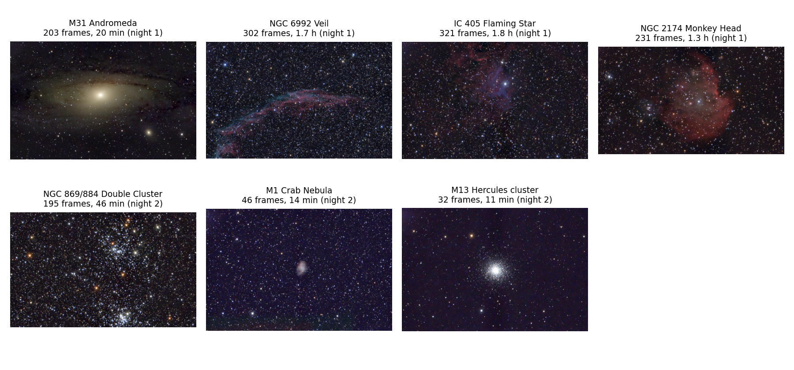
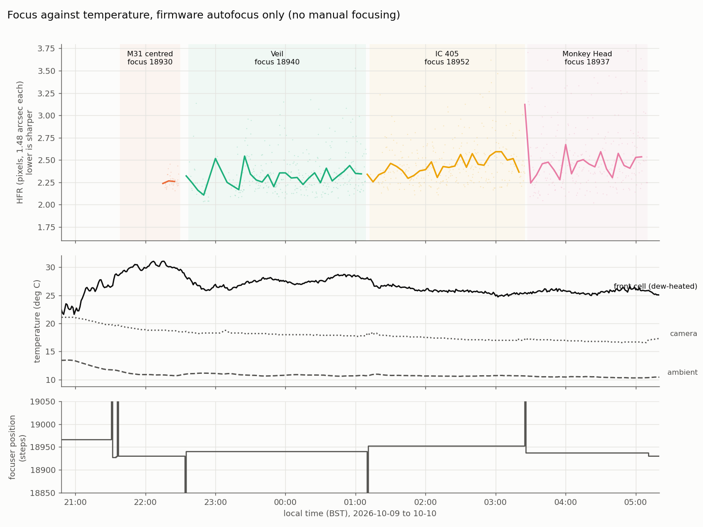
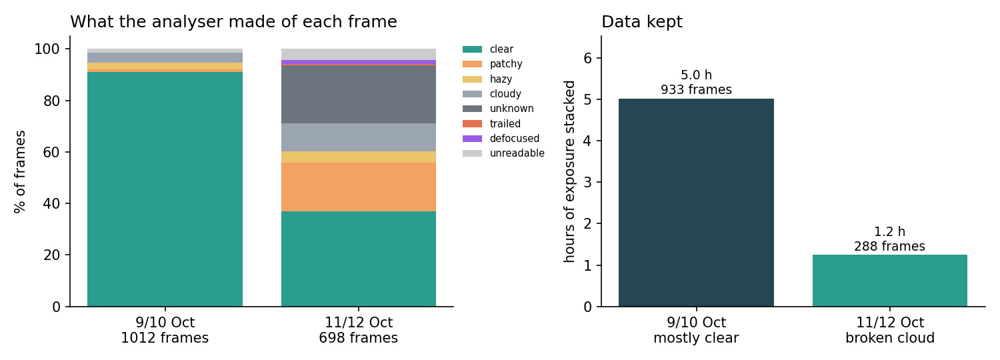
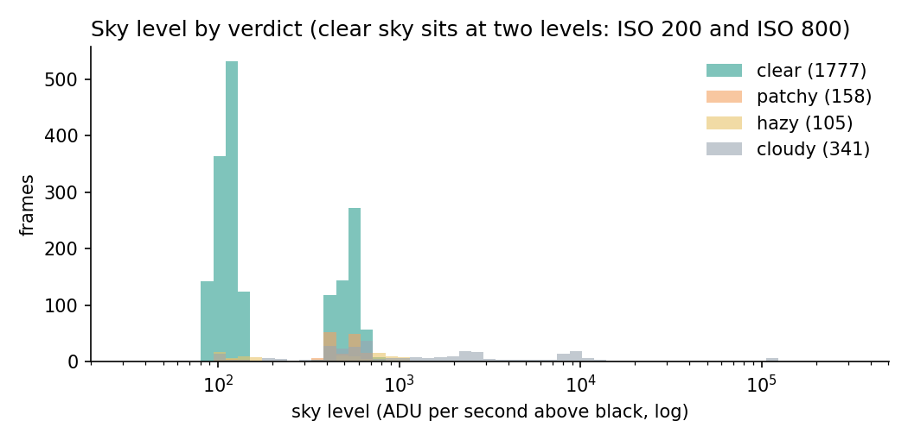
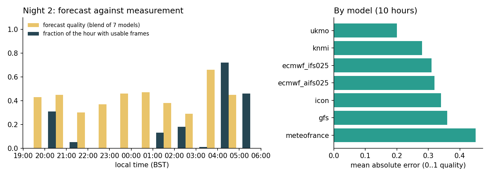
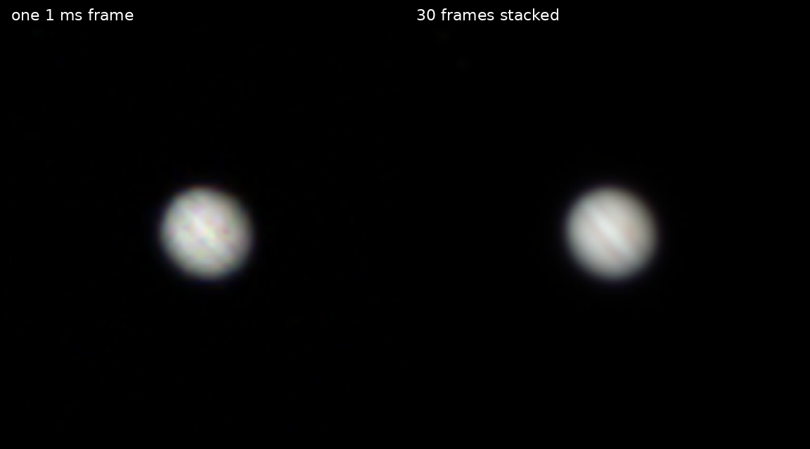

*Standfirst: Cambridge weather gives you a few clear hours at unpredictable times, and a smart telescope can use them better than a person standing in the garden. Over two October nights I let a home-built control program run a Celestron Origin: choose targets, watch the sky, retreat from cloud, refocus, stack and park. This is what worked, what did not, and the many small problems that stood between "it takes pictures" and "it runs the night".*

## Why bother

Electronically assisted astronomy (EAA) has an obvious weak spot: the person. A smart telescope will gladly expose for hours, but somebody has to decide that the sky has clouded over, that the stack has gone soft, that the next target is above the neighbour's roof, and that it is raining. In Cambridge the nice weather is always several days away, and when it does come it arrives for a gap of forty minutes at 2 a.m. If the telescope can look after itself, those gaps stop being wasted.

The Celestron Origin is a good candidate. It is a 152 mm f/2.2 RASA (a Schmidt-type astrograph) on an alt-az mount with a 3056 × 2048 colour sensor, so each frame covers about 75 × 50 arcminutes at 1.48 arcseconds per pixel. It is controlled by an app, over the network, and it exposes enough of that network interface for a program to take its place. It started life as a small monitoring program for the Mac (written with the help of Claude, Anthropic's AI model) and grew into something that runs without a display on a Linux box in the house: a daemon called *OriginHeadless*, a read-only watch window called *OriginWatch*, and a supervisor that makes the decisions. It is about fifteen thousand lines of C++, all open source on GitHub (jrrk2/OriginMonitor).

This article describes two nights in October 2026. The first (9/10 October) was mostly clear; the program's sequencer imaged while an AI session supervised it live. The second (11/12 October) was broken cloud and used the new unattended supervisor, which made it a much better test.

## How it is put together

* **The daemon** talks to the telescope (a WebSocket for commands and status, plain HTTP to fetch the raw FITS frames) and offers a small command port on the local machine. Every operation (slew, snapshot, focus, status) is one command that prints one JSON reply, so it can be driven from a shell script, from the supervisor or by hand.
* **Every frame is analysed** as it arrives: how many stars, how big (half-flux radius, HFR), how round, how bright the sky is, and how it compares with the clear-sky level learned for that exposure and ISO. Each frame gets a verdict: clear, hazy, patchy, cloudy, trailed, defocused. Only good frames go into a live stack for the current target.
* **A planner** works out, for the night, which targets are above a horizon profile for the garden (still partly guesswork), with the Sun below −18° and the Moon away, and in which order to image them. Each block of the plan also carries backup targets for when the first choice is under cloud.
* **A supervisor** follows the plan. It goes to a backup target when the sky turns bad, comes back when it clears, runs a focus sweep when the stars go soft, and parks the telescope on Polaris at the end of the dark or when rain is forecast.
* **Weather.** A blend of seven forecast models from Open-Meteo, plus hourly airport observations and an all-sky camera, decides whether the telescope should go out at all. Two e-mails arrive automatically: at sunset, *is it worth putting out?*, and at 22:00, *is it safe to leave out?*

None of this is clever on its own. The interest is in the places where it broke.

## Night one: a clear sky and what the stacks look like

On the first night the sky was clear apart from a cloudy first hour. The sequencer took 1,012 frames: 920 were clear, 28 hazy, 11 patchy and 37 cloudy; 16 came back unreadable. Of the data on disc, about 18,300 seconds (5.1 hours) went into stacks:

| Target | Frames | Stacked exposure | Settings |
|---|---|---|---|
| M31 Andromeda | 203 | 1,222 s | 6 s, ISO 800 |
| NGC 6992 Eastern Veil | 302 | 6,040 s | 20 s, ISO 200 |
| IC 405 Flaming Star | 321 | 6,420 s | 20 s, ISO 200 |
| NGC 2174 Monkey Head | 231 | 4,620 s | 20 s, ISO 200 |

The top panel of the timeline figure below is that night: a flat line of sky level at about 110 ADU per second from 23:15 to 05:10, with one nebula after another underneath it.

A useful result from this night concerns focus. The Origin runs its own autofocus after every slew, and I had worried that it would drift with temperature over eight hours. It did not. Across four targets the autofocus position stayed between 18,930 and 18,952 steps and the median star HFR between 2.26 and 2.42 pixels (3.3 to 3.6 arcseconds), while the dew-heated front cell sat 15-20° above ambient and the camera cooled by about 4°. I found no usable correlation between HFR and any of the three temperatures. The firmware's autofocus is good enough that the program does not need to second-guess it, provided the autofocus has stars to work with, which becomes important on the second night.

## Night two: broken cloud, and the program had to cope

The forecast for 11 October gave three or four usable hours, with a lot of cloud in between. This is the situation an unattended telescope exists for. Both nights are plotted below on the same axes: sky level (log scale) for every frame, coloured by the analyser's verdict, with the target underneath.

On night two the sequencer took 698 frames. Only 257 were clear; 132 were patchy, 31 hazy, 77 cloudy and 157 could not be scored (the "unknown" frames: too few stars to judge, mostly heavy cloud), with 13 trailed or defocused and 31 unreadable. The data that survived into stacks was about 1.2 hours instead of 5:

* NGC 869/884, the Double Cluster: 195 frames, 2,730 s
* M1, the Crab Nebula: 46 frames, 828 s
* M13: 32 frames, 640 s

Even 14 minutes on M1 shows the Crab. That is the point of live stacking: an hour of data that would have been thrown away on a fixed schedule is enough for a recognisable picture.

The supervisor made 12 target switches (cloud over the current target, a backup target further round the sky, and back again) and recorded each decision with a reason in a log. The logic is simple, and the rule for choosing backups is the interesting part: clouds move with the sky's alt-az frame, so a backup has to be well away from the current pointing (at least 25° in the plan), observable for most of the block, and ranked by the planner's priority.

Honestly, it was not hands-off. The log records 17 run starts during the night, mostly because I restarted the supervisor to deploy a fix after watching a failure (the notes below explain them). The last hundred minutes (the Double Cluster block, 02:46-04:25 UT, followed by an automatic park on Polaris and a summary e-mail) ran through with no restart.

## Challenges and workarounds

The list below is long on purpose. Anyone considering a similar project will meet most of it.

### 1. Frames that are not FITS

After every slew the Origin's firmware drops the capture settings (bit depth, exposure, ISO) and then returns a compressed PNG for the next snapshot. A PNG is useless to the analyser. The fix was to send "16-bit" with every capture request and to retry once automatically. It works most of the time but not always: 16 of 1,012 frames on night one and 31 of 698 on night two still came back unreadable, often the first frame after a slew.

### 2. Cycle time: a ghost of my own making

At first a 15 second exposure took 31 seconds, a duty cycle of 48%. I spent about 45 minutes chasing a fixed 7 second "overhead" in the telescope. The cause was my own setting: the capture waits for the live-view frame in progress, and I had left the live exposure long. Setting it to 0.5 s gave 23 seconds for a 20 second frame, a duty cycle of 87%. The lesson, which I was told again and again by the logs, is to read the message timeline first. The telescope's log showed the answer in one look.

### 3. Telling clouds from trees

A frame can be bad because of cloud, or because the telescope is pointing at a roof or a tree. They need different responses. Cloud moves on, so the supervisor waits; a roof does not, so the planner should learn to avoid that direction. The program attributes each bad frame to a cause from evidence: a sky *brighter* than clear-sky level points to cloud, a sky *darker* than the baseline, or a pointing at or below the measured horizon, points to an obstruction, and anything above 60° altitude is cloud by definition (the nearest tree is not that high). Only obstruction-attributed frames create a blocked direction in the learned map.

The sky level does most of the work. The histogram below shows every frame from the two nights: clear sky sits at one of two levels (about 110 ADU per second at ISO 200 and about 550 at ISO 800), and cloud lights the sky up by factors of ten to a thousand. The honest limitation is that no real obstruction has been recorded yet, so the obstruction side of the classifier is untested.

### 4. A bad frame can poison a night

The live stacker aligns each new frame to a reference. If the reference is a frame lit by cloud or out of focus, every later good frame fails to register and is dropped, which looks exactly like more cloud. This happened several times on night one (reference seeded from cloud) and again on night two, when the frames from one of my own focus scans ended up in the M1 stack. The rules now are that a reference needs at least 25 round stars and an HFR under 4 px, and that a small bad stack (ten frames or fewer, or under five minutes of exposure) is replaced if three sharp frames in a row fail to register against it. On night one a single freak frame had also set the "best transparency" reference to 1,207, after which every real frame read as cloud; outlier guards for that are still on the to-do list.

### 5. Autofocus with no stars

This one was subtle. The firmware's autofocus after a slew runs whether or not there are stars. Under cloud it hunts blindly and can leave the focuser far from focus, and the next clear frame shows stars as doughnuts. The analyser first called these "unknown, 0 stars", the same label as cloud, so the supervisor kept waiting for a clearing that had already happened.

The fix is a new verdict, *defocused*: many stars detected but all large, or fewer than 15 round stars with the big ones dominating. On that verdict the supervisor first re-centres with a fresh slew (which re-runs the autofocus), then, if that fails, runs its own wide focus sweep. At 02:27 UT on night two that sequence happened by itself on M45: defocused, re-centre, still defocused, sweep (best position 18,982, HFR 2.38 px with 150 stars), carry on. The best focus found on night two, 18,980-19,034 steps with HFR 2.2-2.5 px, is a few tens of steps from night one's 18,930-18,952, with the same star sharpness.

### 6. "Aligned" that was not

The mount's own `initialize` command can report success after failing. After a failed alignment the mount sits idle and says nothing, but the flag that matters, `IsAligned`, is false, and the log carries an error ("Did not find enough stars for alignment") that the next status message overwrites. The program now requires `IsAligned`, keeps the error, and the launcher checks alignment before it starts a run. Failures of the "not enough stars" kind do not count towards the retry limit, because they say more about the sky than about the mount.

### 7. Plate solving, and starting before dark

If the telescope can solve its own frames, it can start earlier and know where it is. Astrometry.net's `solve-field` is run on a snapshot, with one non-obvious flag: `-z2`, which reduces the frame by two because the one-shot colour sensor leaves a Bayer pattern that otherwise defeats the star detector. A good frame solves in about 11 seconds, and agreement with the mount's own position is better than 0.03°, which is two arcminutes.

The launcher now starts when the Sun is below −7° instead of waiting for −12°. It uses an exposure scaled to how bright the sky is, and tries again with longer exposures if the frame is unsolvable. On the evening of 11 October the tries at Sun −7.8° and −9.4° found too few stars. At −10.9° a 1.08 s frame had 51 stars and solved: RA 15.28 h, Dec +74.6°, the tube at altitude 55.8° and azimuth 334.2° (the tilt sensor said 57° for altitude). That solve is the first time the system learned which way the telescope was pointing, because I put the telescope out pointing roughly north and the mount cannot know its azimuth until a frame is solved. Imaging itself still waits for −12°.

### 8. The weather forecast, scored

Because the program takes a forecast of each night before it starts, and compares it with the frames afterwards, there is now a record of how right the forecast is. After one night (ten hours with enough frames) the blended forecast of seven models averaged a quality of 0.43; the sky delivered 0.19. The forecast was too optimistic by 0.24, which is the opposite of what I had expected. Of the seven models, the UK Met Office's (UKMO) did best (mean absolute error 0.20) and Météo-France's worst (0.45). One night is not a ranking, and I will not believe it until I have ten.

A related problem: the planner drops a target if the forecast quality is under 0.2, and on night two it dropped M1 while the sky above was clear. I got round it by launching the run by hand with the forecast filter off. Whether the nowcast (airport observations and the all-sky camera) should override the forecast is still undecided.

### 9. Things that turned out not to be worth doing

* **Flat frames.** I measured the vignetting from twilight and overcast flats: the corner is at 0.971 of the centre (3%), and there is no dust shadow at 3% depth or more (noise 0.5%). The RASA is easy on flats. I wrote the tool, took the data, and decided not to use the master flat.
* **The telescope's own imaging mode.** It stores every sub on the 58 GB internal disc and does not delete them after download, and it offers no per-frame quality check. A bad sub can only be left out afterwards. The per-frame verdicts are what let the supervisor stop and probe in cloud, so the program uses single "sample" captures instead.

## An aside: Jupiter at dawn, and a lesson in coordinates

On the Monday morning, with the Sun at −5° and the sky too bright for any of the programme's targets, I tried a dawn planet.

The first attempt failed. I took Jupiter's position from the Python library astropy, and the telescope slewed to a patch of sky with a single star in it. Jupiter was not in the field. I blamed the telescope's pointing for a few minutes, which was unfair: the telescope was exactly where I had told it to go. The fault was mine. In astropy, taking an ICRS position of a planet gives its direction as seen from the centre of the Solar System, not from the Earth, and for Jupiter at 5.8 AU that is about 9° wrong (8.98 h, +17.8° instead of 9.58 h, +15.05°). The altitude and azimuth that astropy gives for the same call are correct, which is why the numbers seemed plausible until the frame came back.

I then centred Jupiter by hand, and the mount reported 9.5823 h, +15.046°. The JPL ephemeris (DE440, through NASA's CSPICE toolkit) gives 9.582 h, +15.047° for the same moment: they agree to under an arcminute. The program now has a `body` command (planet, Moon or Sun positions from DE440, topocentric) and `goto-body`, astropy is reduced to a sanity check in one script, and a note is saved so I do not repeat the mistake.

The exposure lesson came next: Jupiter at ISO 800 saturates in a millisecond. The camera takes exposures as short as one microsecond. At ISO 100 and 1 ms the disc peaks at about 35,000 ADU against a 65,535 limit with an almost black sky. Thirty frames of 1 ms, taken in about 70 seconds, were registered on the disc and averaged; the belts are much clearer in the stack than in a single frame.

## What I have not solved

* **Trailing after the first slew.** On night two the stars trailed for about six minutes after the first goto, to M31, then were fine. I measured the tracking rate afterwards and it was right (1.00 of sidereal in both axes). I do not know why. The supervisor now re-centres automatically when it sees coherent trails (two such events on night two), but that is a patch.
* **The obstruction map has never seen an obstruction.** I wrote a twilight survey that points at the places the night's plan will use and records whether the view is blocked. On Monday morning I ran it at Sun −3°, because I judged the sky dark enough by eye. It was not: all four frames were dominated by dawn (sky level 560,000 ADU per second), and three of them were taken in the direction of a southern cloudbank. The survey recorded no obstruction but also learned nothing. It needs to be run between about −9° and −12°.
* **Reconnection.** The daemon does not yet reconnect by itself if its link to the telescope drops, and the cron job that starts each night is a stopgap.
* **Glare.** Neighbours' security lights wash out part of the sky. The program learns this the same way as the obstruction map, but it needs clear dark nights I have not had since.

## Lessons for anyone trying this

1. **Judge frames, not hours.** A per-frame verdict (stars, size, sky level against the known clear level) is the foundation. Everything else, from backup targets to parking, reads from it.
2. **Make failures loud and records permanent.** Every supervisor decision is a line in a log file with a reason attached. Most of my mistakes were found by reading the log of the previous hour, not by watching the telescope.
3. **Treat the firmware as another opinion, not a truth.** It centres by a few arcminutes, autofocuses blindly under cloud, forgets its settings after a slew and says "success" when it did not align. Check what it claims.
4. **Test on the real sky early.** The simulator I used is a fine software check, but almost every problem in this article appeared only on the real instrument under a real, uncooperative sky.
5. **Keep records of the supervisor's mistakes too.** An AI assistant supervised a lot of this work, and it was wrong in several ways I can name: it read focus scores before looking at the image, corrected a pointing error in the wrong direction (turning 12 arcminutes into 23), and chased a phantom overhead for three-quarters of an hour. All of this is in the repository's audit trail. If you use an assistant like that, ask it to write down its errors.

## Numbers for the notes

| | Night 1 (9/10 Oct) | Night 2 (11/12 Oct) |
|---|---|---|
| Weather | Mostly clear after a cloudy first hour | Broken cloud, clear 04:00-05:25 |
| Frames taken by the sequencer | 1,012 | 698 |
| Clear / patchy / hazy / cloudy / unscored | 920 / 11 / 28 / 37 / 0 | 257 / 132 / 31 / 77 / 157 (plus 13 trailed or defocused) |
| Unreadable (PNG) frames | 16 | 31 |
| Data stacked | about 5.1 h | about 1.2 h |
| Targets imaged | M31, Veil, Flaming Star, Monkey Head | Double Cluster, M1, M13 |
| Run control | in-app sequencer, supervised live | unattended supervisor; 17 run starts logged, most to deploy fixes |

The software is at github.com/jrrk2/OriginMonitor. The README has a longer account of both nights and a full list of the errors made, mine and the assistant's. Observations and code are free to use. If you have an Origin and a spare network port, I would be glad to compare notes at a meeting.

*Equipment: Celestron Origin (152 mm f/2.2 RASA, 3056 × 2048 colour sensor), Cambridge, UK. Frames are raw FITS; stacks are live-stacked by the software with no further processing. Ephemerides: JPL DE440 through NAIF CSPICE. Weather: Open-Meteo forecast models and aviationweather.gov airport observations.*
